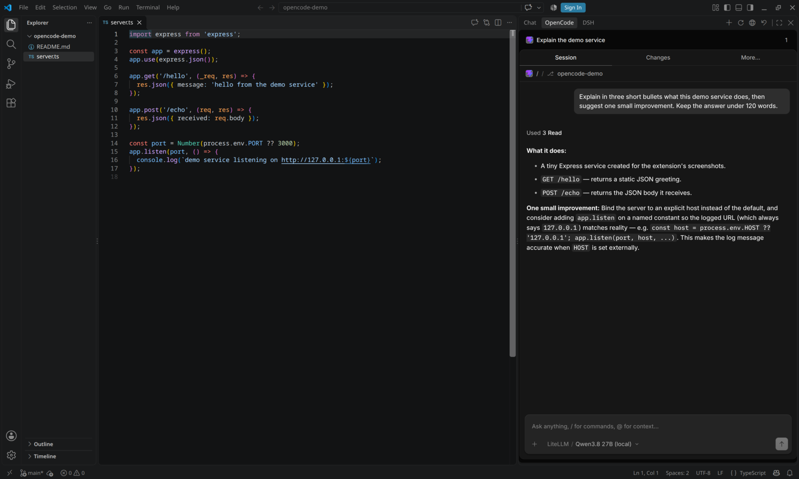
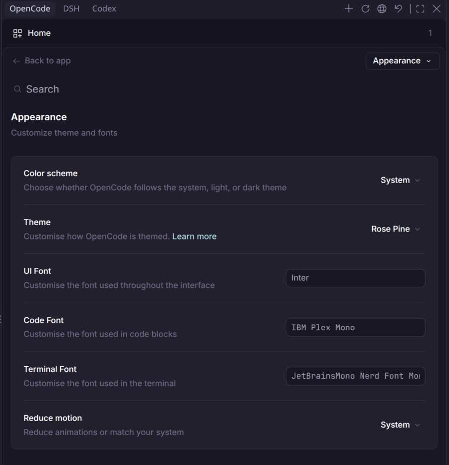
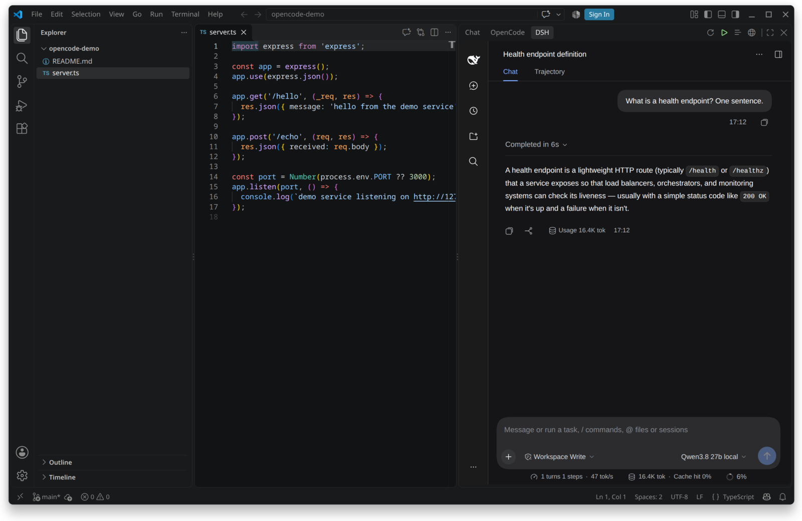
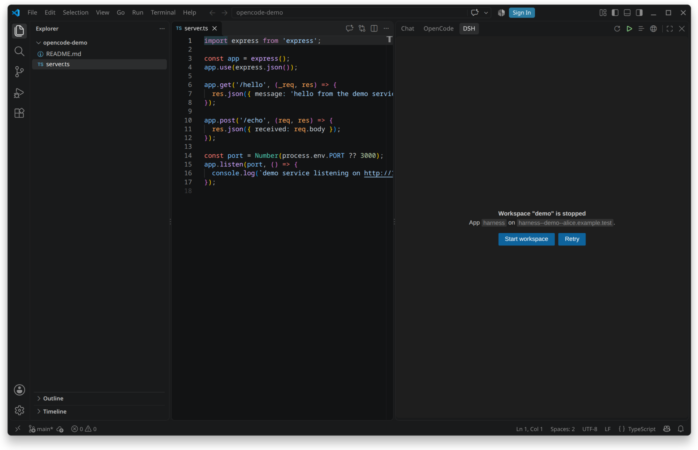

# OpenCode & DSH Web (Sidebar)

[](https://marketplace.visualstudio.com/items?itemName=Alamion.opencode-dsh-web)
[](https://marketplace.visualstudio.com/items?itemName=Alamion.opencode-dsh-web)
[](https://marketplace.visualstudio.com/items?itemName=Alamion.opencode-dsh-web)
[](https://github.com/Alamion/opencode-dsh-web)
[](https://github.com/Alamion/opencode-dsh-web/actions/workflows/ci.yml)
[](LICENSE)
[](https://code.visualstudio.com)

Open the [OpenCode](https://opencode.ai) web UI and the DeepSeek Harness (DSH)
web UI in the VS Code **secondary sidebar** (the right column, next to the
Claude Code / Codex panels) — pre-authenticated, at your project and last chat.

Both panels work with **local servers** out of the box. **Coder is optional**:
either panel can instead open a Coder workspace app, using the same Coder
login and workspace settings.

## Features

- **OpenCode panel** — the official OpenCode web UI, reached through a local
  authenticating proxy, deep-linked to the last chat of the current folder.
  Runs against a local OpenCode server **or an optional OpenCode Coder app**.
- **DSH panel** — the DeepSeek Harness web UI (`dsh --profile web`), either the
  local server **or an optional Coder workspace app** such as the bundled Harness app,
  with automatic sign-in.
- **Coder mode for both panels (optional)** — one Coder session, two sidebars;
  resolve the workspace, app and launch URL automatically, start stopped
  workspaces, and keep the Coder token server-side.
- **No login forms** — local proxies inject OpenCode Basic auth and the Coder
  session token, so the panels open pre-authenticated.
- **Project-aware** — deep links to the last chat in the current folder and
  stable per-workspace origins.
- **Shared OpenCode appearance (optional)** — theme, color scheme, fonts and
  other Appearance settings synchronised between VS Code windows, with an
  optional wider preference sync.

## Coder mode (optional)

Coder support is a feature, not a requirement. Leave it off for local-only
work; enable it per panel when the workspace lives in Coder.

| Panel | Local (default) | Coder (optional) |
| --- | --- | --- |
| **OpenCode** | `opencodeWeb.mode=local` + `opencodeWeb.serverUrl` | `opencodeWeb.mode=coder` + a Coder app with slug `opencode`, or `mode=auto` |
| **DSH** | `dshWeb.mode=local` (or `auto` without Coder) | `dshWeb.mode=coder` (or `auto` with Coder) + `harness` app (or another DSH app) |

Both panels share the Coder connection settings: `dshWeb.coder.url`, `.token`,
`.owner`, `.workspace`, `.appDomain` and `.agent`. OpenCode adds its own app
slug, remote directory and password under `opencodeWeb.coder.*`.

The Coder path is fully server-side in the extension: the webview never needs
the Coder token or the app's own auth cookie. For DSH the proxy also completes
the launch-token exchange; for OpenCode it injects Basic auth and the appearance
profile. Coder workspaces that are stopped show a **Start workspace** action
for DSH, and a clear retry/setup panel for OpenCode.

## Screenshots









More details and the capture notes are in
[`docs/screenshots`](docs/screenshots).

## Requirements

- VS Code 1.90 or newer.
- For the OpenCode panel: a reachable local OpenCode server (`opencode serve` /
  `opencode service start`, default `http://127.0.0.1:4096`). Coder is
  optional; enable `opencodeWeb.mode=coder` only when an OpenCode Coder app is
  available.
- For the DSH panel: a local `dsh` on `PATH` (or an already running DSH web
  GUI). Coder is optional; enable `dshWeb.mode=coder` only when a Coder
  deployment and workspace app are available.

## Install

From the Marketplace search for **OpenCode & DSH Web**, or install a packaged
build:

```bash
code --install-extension opencode-dsh-web-0.1.0.vsix
```

## Quick start

| Action | Default key |
| --- | --- |
| Open the OpenCode panel | `Alt+O` |
| Open the DSH panel | `Alt+D` |

Both panels also expose buttons in the view title bar and an
`OpenCode Web: Open Sidebar` button in the editor title bar.

External links can open a panel too:
`vscode://Alamion.opencode-dsh-web/open-opencode` and
`vscode://Alamion.opencode-dsh-web/open-dsh` (VS Code asks for confirmation the
first time).

## First run

- **OpenCode** — if the server is unreachable or the password is missing, the
  panel shows a **Connect to OpenCode** form with the server URL and password,
  plus **Open Settings** and **Save & Connect** buttons. For a local server,
  leave the password empty when `~/.config/opencode/service.json` exists; the
  extension reads it. `opencode service start` creates that file if needed.
- **DSH local** — the first open starts `dsh --profile <profile>` and remembers
  the `dsh web: <url>` launch URL. If authentication fails, paste a fresh launch
  URL in the panel or run **DSH Web: Set Launch URL**.
- **OpenCode Coder (optional)** — set `opencodeWeb.mode=coder` plus the Coder
  workspace and `opencodeWeb.coder.*`. If the session is missing, the workspace
  is stopped, or the app/password is wrong, the panel shows a Retry / Open
  Settings message instead of an empty webview.
- **DSH Coder (optional)** — when no Coder session is found, the panel offers
  **Coder Login**. When a workspace exposes several apps, it offers **Select
  app**.

## OpenCode

The extension starts a small local proxy that talks to your OpenCode server and
adds the HTTP Basic credentials, so the panel is signed in without a login form
or pair link. The password comes from `opencodeWeb.password`, or from
`~/.config/opencode/service.json` when the setting is empty.

Each workspace folder gets its own stable proxy port, so the panel keeps an
isolated webview origin — and with it the OpenCode UI state (the selected
project and the open chats). Whenever the panel is opened (including after a
window reload) it deep-links to the **last chat you opened** in the current
folder, rather than the all-sessions list.

Set `opencodeWeb.mode` to `coder` to use an OpenCode web UI exposed as a Coder
workspace app. `auto` uses Coder when `dshWeb.coder.workspace` is set (handy
when both panels target the same Coder workspace) and local otherwise. The extension starts a Coder proxy (Coder session token and app
host) and the ordinary OpenCode proxy in front of it (Basic auth and appearance
sync). The Coder connection settings are shared with DSH:
`dshWeb.coder.url`, `.token`, `.owner`, `.workspace`, `.appDomain`, `.agent`.
Set `opencodeWeb.coder.appSlug` to the app slug (default `opencode`) and
`opencodeWeb.coder.directory` to the remote project directory used for sessions
and deep links.

`opencodeWeb.syncAppearance` shares the web UI theme, color scheme, fonts and
other Appearance settings between windows through the proxy. Theme changes are
pushed live; font and layout changes reload an unfocused panel. Set
`opencodeWeb.syncPreferences` to also share general preferences, keybindings,
notifications, sounds, language and motion tuning. Project permissions and
workspace lists stay local. **OpenCode Web: Reset Shared Appearance** clears
the shared profile and the synced state of every open panel.

## DSH

`dshWeb.mode` selects the target:

- `auto` (default) — use Coder when a deployment URL and session are found,
  otherwise the local DSH server.
- `coder` — only a Coder workspace app.
- `local` — only a local `dsh --profile <profile>` server.

### Local DSH

With `dshWeb.mode` set to `local`, the panel talks to `dshWeb.url`
(default `http://127.0.0.1:3080`). If it is unreachable and `dshWeb.autoStart`
is on, the extension starts `dsh --profile <dshWeb.profile> --no-open` and
remembers the authenticated launch URL it prints.

DSH authenticates a browser with a one-shot launch token that mints a signed
`dsh-auth-*` cookie. If the extension did not see the launch URL, the panel asks
you to paste the `dsh web: <url>` line once.

### DSH as a Coder workspace app

A Coder workspace app lives on a subdomain of the deployment,
`<slug>[--<agent>]--<workspace>--<owner>.<appDomain>`, and is protected by the
Coder session. VS Code webviews keep cookies in a separate jar, so the panel
reaches the app through a local proxy that injects the `Coder-Session-Token`
header. The proxy also completes DSH's own launch-token exchange **server-side**
and holds the `dsh-auth` cookie itself, so the webview needs no cookie at all
(this is what keeps the panel from looping and hitting Coder's rate limit).

The panel:

1. Reads the deployment URL and session token from settings or from disk
   (`~/.config/coderv2/url`, `~/.config/coderv2/session`, or the `coder-remote`
   extension's global storage).
2. Resolves the owner (the logged-in user) and a workspace (an explicit
   `$CODER_WORKSPACE_NAME`, the only owned workspace, the only running one, or
   the most recently used one).
3. Resolves the app slug: `dshWeb.coder.appSlug` when set, otherwise the single
   app of a running workspace. With several apps it asks you to pick one
   (**DSH Web: Select Coder App**), which stores `dshWeb.coder.appSlug`.
4. If the workspace is not running, shows its status and a **Start workspace**
   button (or starts it automatically when `dshWeb.coder.autoStartWorkspace` is
   on) and waits until the app answers.
5. Starts the local proxy on a stable port and opens the app.

If the Coder session expires, the panel offers **DSH Web: Coder Login**.

DSH stores theme and font size in the Host user-settings document
(`ui-theme` namespace), so a local loopback panel already shares them across
projects. DSH does not create that host-backed settings scope for non-loopback
pages, so appearance changes in a Coder workspace app may not persist across
reloads; that limitation is inside DSH rather than this extension.

## Settings

### OpenCode

| Setting | Default | Description |
| --- | --- | --- |
| `opencodeWeb.serverUrl` | `http://127.0.0.1:4096` | OpenCode server URL. |
| `opencodeWeb.password` | *(from service.json)* | Server password. |
| `opencodeWeb.autoStart` | `true` | Run `opencode service start` when the server is unreachable. |
| `opencodeWeb.deepLink` | `always` | Open the last chat: `always`, `first`, or `never`. |
| `opencodeWeb.mode` | `local` | `local` uses `serverUrl`; `coder` uses an OpenCode Coder app; `auto` picks Coder when `dshWeb.coder.workspace` is set. |
| `opencodeWeb.coder.appSlug` | `opencode` | Coder app slug for the OpenCode web UI. |
| `opencodeWeb.coder.directory` | `""` | Remote project directory for sessions/deep links in Coder mode. |
| `opencodeWeb.coder.password` | `""` | OpenCode Basic password inside the Coder workspace. |
| *(Coder connection)* | *(shared)* | `dshWeb.coder.url`, `.token`, `.owner`, `.workspace`, `.appDomain`, `.agent` are used by both panels. |
| `opencodeWeb.syncAppearance` | `true` | Share the OpenCode web UI theme and Appearance settings across windows. |
| `opencodeWeb.syncPreferences` | `false` | Also share general preferences, keybindings, notifications, sounds, language and motion tuning. |
| `opencodeWeb.openOnStartup` | `false` | Focus the OpenCode panel when a window starts. |

### DSH

| Setting | Default | Description |
| --- | --- | --- |
| `dshWeb.mode` | `auto` | `auto`, `coder`, or `local`. |
| `dshWeb.url` | `http://127.0.0.1:3080` | Local DSH web GUI (in `local` mode). |
| `dshWeb.profile` | `web` | Profile to boot for a local DSH. |
| `dshWeb.autoStart` | `true` | Boot the local DSH when it is unreachable. |
| `dshWeb.openOnStartup` | `false` | Focus the DSH panel when a window starts. |
| `dshWeb.coder.url` | *(from `~/.config/coderv2/url`)* | Coder deployment URL. |
| `dshWeb.coder.sessionPath` | *(auto)* | Path to the Coder session-token file. |
| `dshWeb.coder.token` | `""` | Session token used directly (overrides `sessionPath`). |
| `dshWeb.coder.appSlug` | `""` | App slug to open; empty means auto-detect. |
| `dshWeb.coder.appDomain` | *(deployment host)* | Domain the app hosts live on. |
| `dshWeb.coder.workspace` | *(auto)* | Workspace name. |
| `dshWeb.coder.owner` | *(logged-in user)* | Workspace owner. |
| `dshWeb.coder.agent` | `""` | Agent label to include in the app URL. |
| `dshWeb.coder.autoStartWorkspace` | `false` | Start a stopped workspace automatically. |
| `dshWeb.coder.cli` | *(auto)* | Path to the `coder` CLI for the Login command. |

## Commands

- **OpenCode Web: Open Sidebar** (`Alt+O`)
- **OpenCode Web: New Session**
- **OpenCode Web: Open in System Browser**
- **OpenCode Web: Reload**
- **OpenCode Web: Reset Shared Appearance**
- **DSH Web: Open Sidebar** (`Alt+D`)
- **DSH Web: Reload**
- **DSH Web: Open in System Browser**
- **DSH Web: Start Coder Workspace**
- **DSH Web: Select Coder App**
- **DSH Web: Coder Login**
- **DSH Web: Set Launch URL**

## How it works

Both panels render a webview that embeds the target UI in an iframe. Each target
is fronted by a local `127.0.0.1` proxy child process (started with
`ELECTRON_RUN_AS_NODE`) so that VS Code's own proxy support
(`http.proxySupport=override`) cannot intercept `http.request` and hang up on
the loopback target:

- The OpenCode proxy injects `Authorization: Basic opencode:<password>`.
- When appearance sync is on, the OpenCode proxy also injects a small profile
  script into `index.html`, captures `localStorage` changes and streams updates
  to other panels over SSE.
- The Coder proxy injects `Coder-Session-Token`, forces `Host`/`Origin` to the
  app host, and performs DSH's launch-token exchange itself.

The proxies bind to `127.0.0.1` only, and their ports are derived from the
workspace path or the Coder target, so the webview origin stays stable across
reloads.

## Security

- The proxies listen on loopback only. Anyone who can reach that loopback port
  gains the injected credentials, so do not expose it.
- The Coder session token is read from disk (or settings) and never leaves your
  machine except to your own deployment.
- The shared appearance profile is a `0600` file in the extension global
  storage. Its write endpoint requires a custom header, so a random web page
  cannot overwrite it through localhost.
- Nothing is telemetry-tracked by this extension.

## Troubleshooting

- **"Coder is not configured"** — set `dshWeb.coder.url` or log in with the
  coder CLI so `~/.config/coderv2` exists.
- **"Coder session expired"** — run **DSH Web: Coder Login**.
- **"Select a Coder app"** — the workspace exposes several apps; run
  **DSH Web: Select Coder App** or set `dshWeb.coder.appSlug`.
- **"Workspace ... is stopped"** — use **Start workspace**, or enable
  `dshWeb.coder.autoStartWorkspace`.
- **OpenCode panel shows the sessions list** — set `opencodeWeb.deepLink` to
  `always` (the default) so it re-opens the last chat.
- **The theme does not appear in an existing panel right after an extension
  update** — reload the panel once; an old Workbox service worker may still be
  serving the cached `index.html`.
- **Shared appearance is wrong** — run **OpenCode Web: Reset Shared Appearance**
  and pick the theme again in one window.
- **OpenCode panel shows "Connect to OpenCode"** — enter the server URL and
  password, or fix `opencodeWeb.serverUrl` / `opencodeWeb.password` and click
  **Save & Connect**.
- **OpenCode via Coder is not ready** — set `opencodeWeb.mode` to `coder`, make
  sure the Coder workspace is running and exposes an app with slug
  `opencodeWeb.coder.appSlug`, then set `opencodeWeb.coder.directory` and
  `opencodeWeb.coder.password`.
- **DSH local reports "Failed to load plugins"** — this comes from the local
  DSH profile, not the panel. Reinstall or upgrade that profile; Coder-hosted
  DSH works independently.
- **DSH local says authentication required** — run **DSH Web: Set Launch URL**
  and paste a fresh `dsh web: <url>` line.

## Development

```bash
npm install
npm run build        # bundles dist/extension.js and the two proxy children
npm test             # vitest
npm run typecheck    # tsc --noEmit
npm run package      # build + vsce package
```

Source layout:

```
src/core/       pure logic (no vscode import): URLs, ports, Coder resolution,
                cookies, HTML builders
src/providers/  vscode-facing providers, settings and proxy spawning
src/proxy/      the two plain-Node proxy children (bundled to dist)
tests/          vitest unit tests for the core logic
```

## License

MIT
